# Better Logcat

[](https://plugins.jetbrains.com/plugin/35015-better-logcat)
[](https://plugins.jetbrains.com/plugin/35015-better-logcat)
[](LICENSE)

A modern Logcat tool window for Android Studio, built with Compose (Jewel). It sits next to the built-in
Logcat and keeps what works there (the filter syntax, the device picker) while fixing what gets in the way:
multi-line messages, long JSON, copying, noisy tags, and crashes that scroll away.

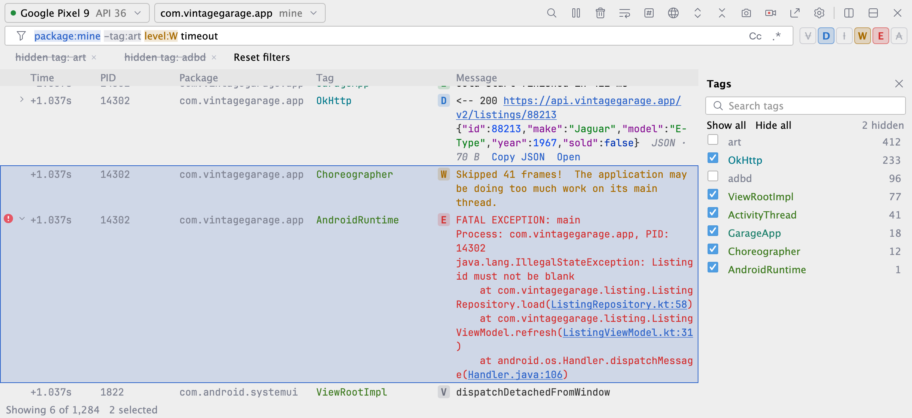

## Highlights

- **Problems panel.** Crashes, ANRs, exceptions, StrictMode violations and warnings, grouped with counts,
  per session. Problems survive Clear and IDE restarts until you delete them, so a crash you cleared by
  accident is still there. Frame drop chart from Choreographer.
- **Messages stay whole.** Stack traces and chunked bodies (Ktor, OkHttp over ~4000 chars) are one entry.
  JSON is detected, colored, pretty printed and foldable.
- **Studio-style search terms** with autocomplete: `package:mine`, `tag:`, `-tag:`, `level:W`, `is:crash`,
  `age:5m`, `status:4xx`, `context:3` and more. See the [search term reference](docs/search-terms.md).
- **The log survives a restart.** After an IDE restart, each device's last log shows again and live lines
  continue below it.
- **Tags panel as a tree.** Show or hide tags with checkboxes, drag tags onto each other to make groups.
- **Network panel** for Ktor and OkHttp: requests paired with responses, copy the path, URL or cURL.
- **Tabs and split panes**, each with its own device and filter, remembered per project.

## A quick tour

### Problems that stay

Every crash, ANR, exception, StrictMode violation and warning gets a gutter icon and a row in the Problems
panel, grouped by kind with a count. Click a row to jump to its newest line, again for older ones. Each app
launch starts a new session; earlier sessions stay below, also after Clear and IDE restarts.

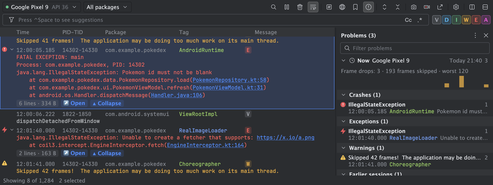

### Big responses, readable

Chunked Ktor and OkHttp bodies join into one entry. JSON is colored, pretty printed when expanded, and one
compact line with **Copy JSON** and **Open** when collapsed. Click the line that opens a block to fold it.
A huge body scrolls smoothly; a sticky header keeps its actions in reach, and a path bar
(`{ } › results › [3]`) shows where you are and folds a block with one click.

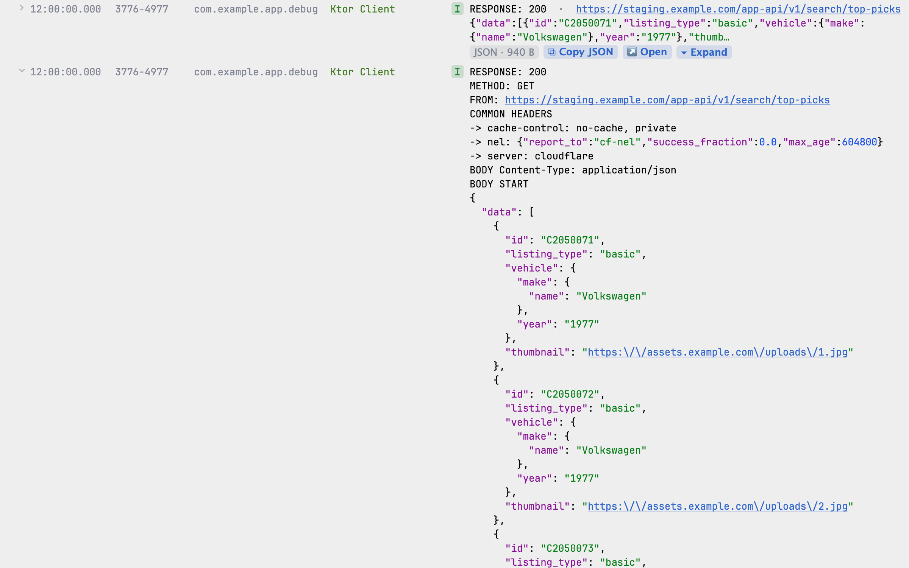

### Short addresses

Add the base URLs you see all day in View Settings, for example `https://pokeapi.co/api/v2`. Log lines
then show `/pokemon/1/`; a click still opens the full address.

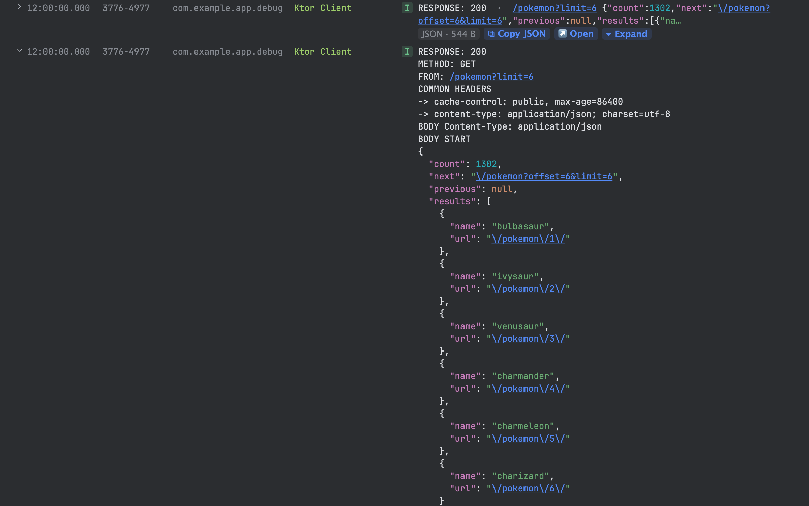

### Network calls

The Network panel pairs each request with its response. In the log, a collapsed HTTP row shows the method,
a Ktor response shows how long the call took, and status codes are colored by class. Filter calls with
`method:POST`, `status:5xx` or `is:http`. The call list shows the path; right-click a call,
or use the buttons under the address, to copy the path, the full URL, the request or response, or a cURL
command.

<table>
  <tr>
    <td width="66%">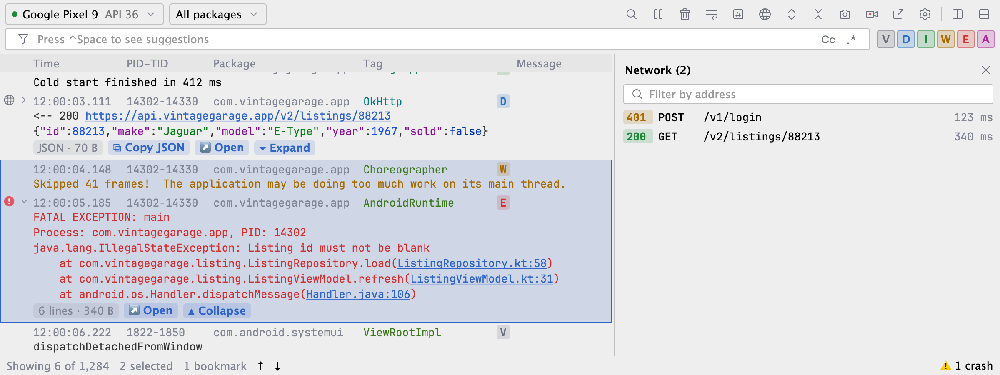</td>
    <td width="34%">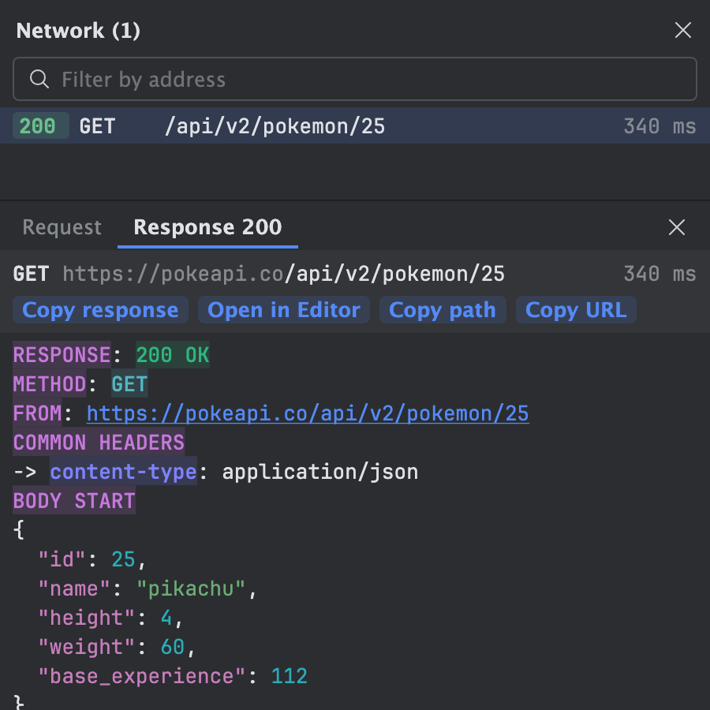</td>
  </tr>
</table>

### Search terms and saved filters

Type `package:mine`, `tag:`, `level:W`, `is:crash` or `age:5m` with autocomplete (Ctrl+Space). Terms are
colored in the search text and stay editable. Favorites and history keep their match counts.

<table>
  <tr>
    <td>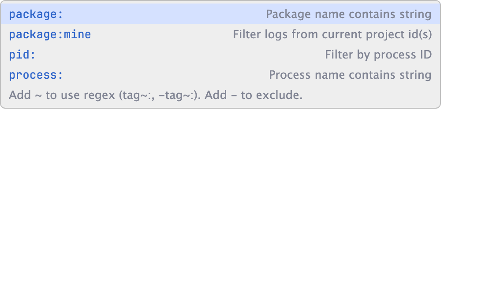</td>
    <td>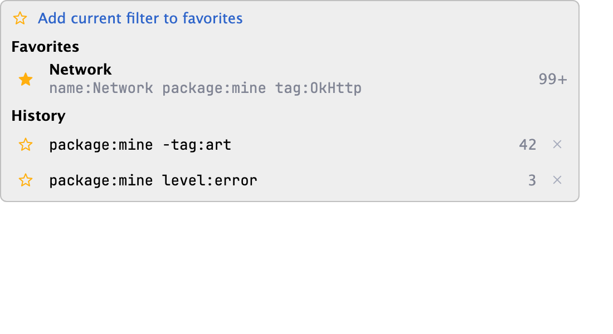</td>
  </tr>
</table>

### Tags, your way

The Tags panel splits your app's tags from the rest, with counts and per-second sparklines. Check or uncheck
to show or hide; drag tags together into groups. Under `package:mine` it lists only your app's tags.

<table>
  <tr>
    <td width="30%">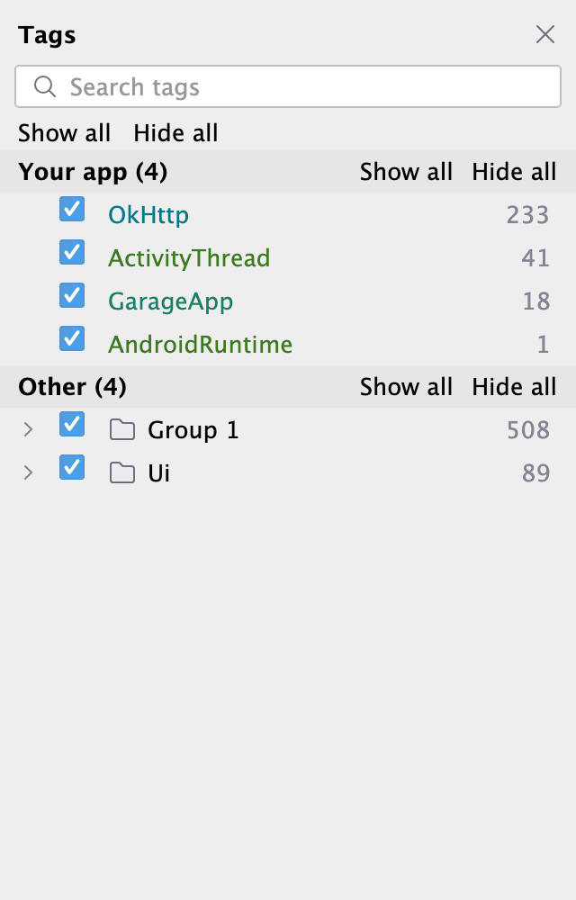</td>
    <td width="70%">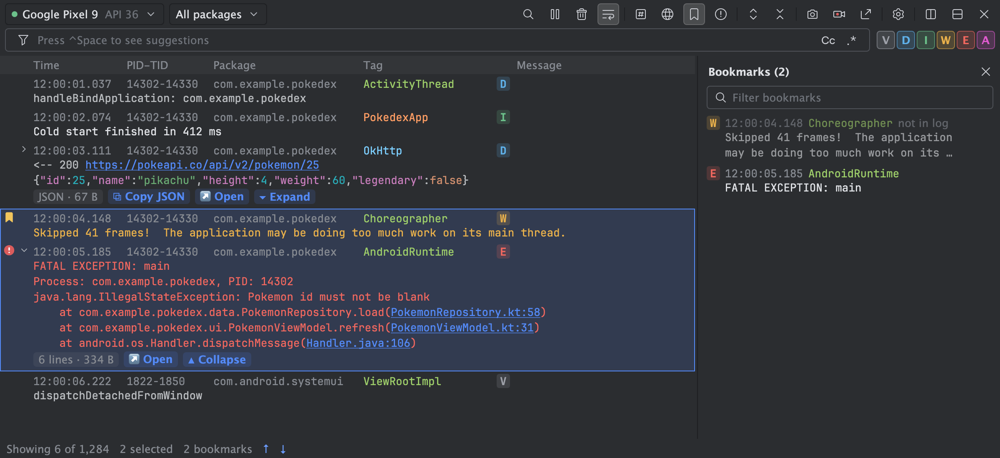</td>
  </tr>
  <tr>
    <td>Tags and groups</td>
    <td>Bookmarks survive Clear and restarts</td>
  </tr>
</table>

### Selection that copies what you mean

Click, Shift-click, Cmd/Ctrl-click or drag to select rows; copy messages only or whole lines. Double-click a
cell to select free text in it.

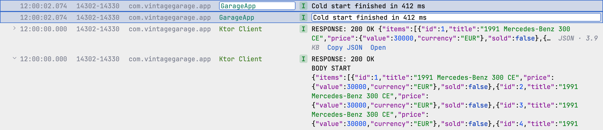

### Make it yours

View Settings apply at once and become the default for new tabs, with a live preview: columns, time format,
soft-wrap, level colors, keyword highlights, package aliases and hidden base URLs.

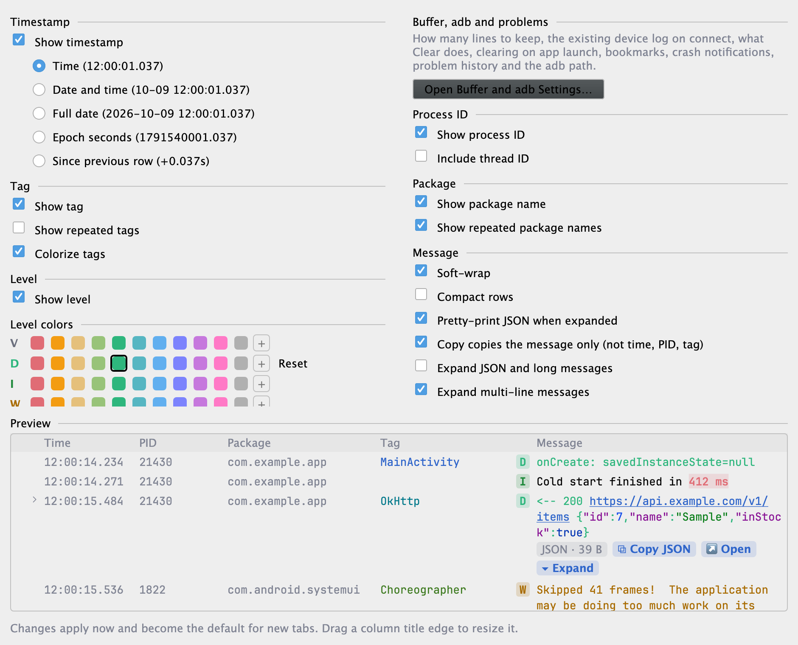

## Features

**Reading logs**
- Multi-line and chunked messages stay one entry. Big messages are virtualized and stay smooth.
- JSON anywhere in a message is colored; expanded rows pretty print it, collapsed rows offer **Copy JSON**
  and **Open** (read-only editor tab). Expanded JSON folds per block, with a path bar in deep bodies.
- HTTP rows show the method, the call time (Ktor) and a status code colored by class.
- Clickable stack frames and links, keyword highlights, per-level colors, R8/ProGuard retrace with a
  `mapping.txt`.
- Hidden base URLs: links show without the base you set; a click opens the full address.
- App start and end markers from ActivityManager.
- `context:N` shows N dimmed lines around each match, like `grep -C`.

**Problems**
- Gutter icons: crash, ANR, exception, StrictMode violation, warning. Click for quick actions.
- Problems panel with sections per kind, a session per device stream and per app launch, and earlier
  sessions below. Every section folds. Rename, delete, delete by age, ignore a noisy problem.
- **Copy as Issue (Markdown)**: the exception, app version (read from the device), device, time and trace.
- **Symbolize Native Crash**: runs the NDK's `llvm-symbolizer` on your build's unstripped `.so` files.
- IDE notification when the app crashes or stops responding while the tool window is hidden.

**Filtering and finding**
- Search terms live in the search text, colored and editable, with autocomplete (Ctrl+Space). Long term
  lists show short until the cursor goes into them.
- `package:mine` follows the app you run, also a build variant whose id Gradle sets at build time.
- Favorites and history behind the funnel button, with match counts. The last filter is restored.
- Level toggles (they write `level` terms into the search text) and the Tags panel: your app vs. other, counts, per-second sparklines, groups. Under a
  `package:` filter it lists only the tags those packages logged.
- Find bar (Cmd/Ctrl+F) moves between matches without changing the filter.

**Working with entries**
- Block selection (click, Shift, Cmd/Ctrl, drag), keyboard navigation, copy messages or whole lines,
  double-click a cell to select free text.
- Bookmarks: click the gutter; the Bookmarks panel lists them and opens saved copies of lines that left
  the log.
- Network panel: copy a call's path, URL, body or cURL. Compare two entries in the diff viewer.
- Export to a file, open a saved file later, or compare the shown log with a saved file.

**Devices and layout**
- Tabs and split panes, each with its own device and filter.
- Pair a device over Wi-Fi from the device picker.
- Screenshot and screen recording (MP4 on devices, WebM on emulators).
- Toolbar toggle to clear the log when your app starts.
- The log of each device comes back after an IDE restart, and after a switch to another device and back.

More screenshots and a full walkthrough: [User guide](docs/user-guide.md). The screenshots are rendered
from the plugin's own UI code (see [CONTRIBUTING.md](CONTRIBUTING.md)).

## Install

Requires Android Studio 2026.2.1 (build 262.9437) or later.

From the IDE: Settings | Plugins | Marketplace, search for **Better Logcat**, then Install. Or open the
[JetBrains Marketplace page](https://plugins.jetbrains.com/plugin/35015-better-logcat) and click
**Install to IDE**.

From disk: Settings | Plugins | ⚙ | Install Plugin from Disk, then pick `better-logcat-*.zip`.
Open the **Better Logcat** tool window. Bind a shortcut in Settings | Keymap | "Better Logcat".

## Documentation

- [User guide](docs/user-guide.md): every panel and action.
- [Search terms](docs/search-terms.md): the filter syntax.
- [Problems](docs/problems.md): sessions, history, and how to try each problem kind.
- [Data and privacy](docs/privacy.md): what the plugin stores and where.
- [Contributing](CONTRIBUTING.md): build, test, and code rules.
- Issues and source: [github.com/melihaksoy/BetterLogcat](https://github.com/melihaksoy/BetterLogcat).
- [Changelog](CHANGELOG.md).

## Build

JDK 25 is needed (Android Studio 2026.2 ships Java 25 bytecode).

```bash
./gradlew test buildPlugin -PlocalPlatformPath="/path/to/oldest/Android Studio.app"
./gradlew verifyPlugin -PlocalPlatformPath="<oldest>" -PverifyPlatformPaths="<oldest>,<newest>"
```

Always compile against the oldest supported Studio: newer builds add Jewel overloads that older ones lack.
The zip lands in `build/distributions/`. See [CONTRIBUTING.md](CONTRIBUTING.md) for details.

## Releasing

Push a version tag; GitHub Actions does the rest (sign, publish to JetBrains Marketplace, GitHub release with
the signed zip). See [CONTRIBUTING.md › Releasing](CONTRIBUTING.md#releasing).

## License

Copyright 2026 Melih Aksoy.

Licensed under the [Apache License, Version 2.0](LICENSE). You may use, change and share this plugin,
also commercially, as long as you keep the license and the [NOTICE](NOTICE) file.
