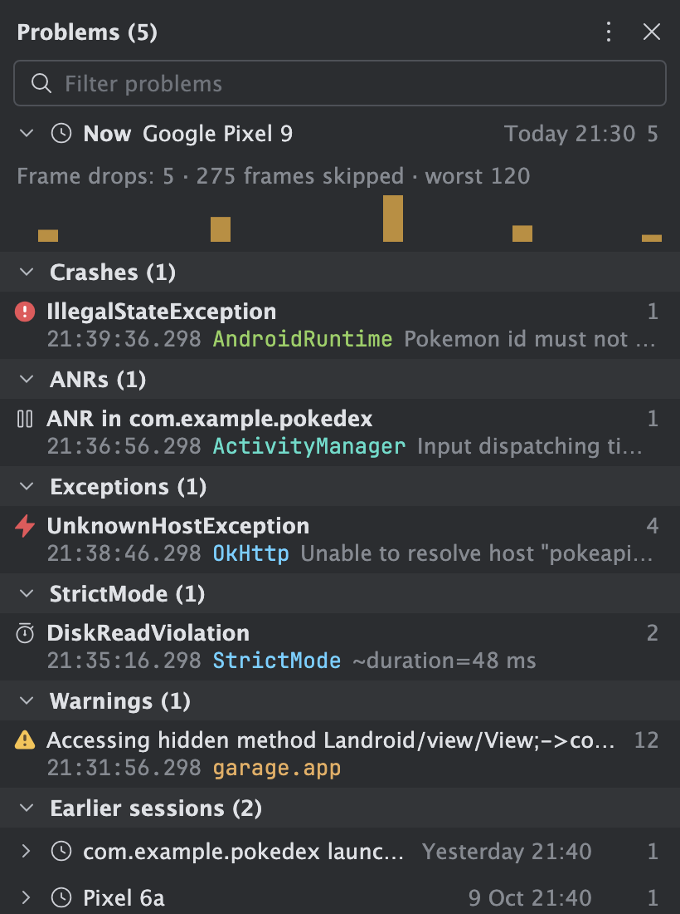

# Better Logcat

[](https://plugins.jetbrains.com/plugin/35015-better-logcat)
[](https://plugins.jetbrains.com/plugin/35015-better-logcat)
[](LICENSE)

A modern Logcat tool window for Android Studio, built with Compose (Jewel). It sits next to the built-in
Logcat and keeps what works there (the filter syntax, the device picker) while fixing what gets in the way:
multi-line messages, long JSON, copying, noisy tags, and crashes that scroll away.


## Highlights

- **Problems panel.** Crashes, ANRs, exceptions, StrictMode violations and warnings, grouped with counts,
  per session. Problems survive Clear and IDE restarts until you delete them, so a crash you cleared by
  accident is still there. Frame drop chart from Choreographer.
- **Messages stay whole.** Stack traces and chunked bodies (Ktor, OkHttp over ~4000 chars) are one entry.
  JSON is detected, colored and pretty printed.
- **Studio-style search terms** with autocomplete: `package:mine`, `tag:`, `-tag:`, `level:W`, `is:crash`,
  `age:5m`, `context:3` and more. See the [search term reference](docs/search-terms.md).
- **Tags panel as a tree.** Show or hide tags with checkboxes, drag tags onto each other to make groups.
- **Network panel** for Ktor and OkHttp: requests paired with responses, Copy as cURL.
- **Tabs and split panes**, each with its own device and filter, remembered per project.



## Features

**Reading logs**
- Multi-line and chunked messages stay one entry. Big messages are virtualized and stay smooth.
- JSON anywhere in a message is colored; expanded rows pretty print it, collapsed rows offer **Copy JSON**
  and **Open** (read-only editor tab).
- Clickable stack frames and links, keyword highlights, per-level colors, R8/ProGuard retrace with a
  `mapping.txt`.
- App start and end markers from ActivityManager.
- `context:N` shows N dimmed lines around each match, like `grep -C`.

**Problems**
- Gutter icons: crash, ANR, exception, StrictMode violation, warning. Click for quick actions.
- Problems panel with sections per kind, a session per device stream and per app launch, and earlier
  sessions below. Rename, delete, delete by age, ignore a noisy problem.
- **Copy as Issue (Markdown)**: the exception, app version (read from the device), device, time and trace.
- **Symbolize Native Crash**: runs the NDK's `llvm-symbolizer` on your build's unstripped `.so` files.
- IDE notification when the app crashes or stops responding while the tool window is hidden.

**Filtering and finding**
- Search terms live in the search text, colored and editable, with autocomplete (Ctrl+Space).
- Favorites and history behind the funnel button, with match counts. The last filter is restored.
- Level toggles and the Tags panel: your app vs. other, counts, per-second sparklines, groups.
- Find bar (Cmd/Ctrl+F) moves between matches without changing the filter.

**Working with entries**
- Block selection (click, Shift, Cmd/Ctrl, drag), keyboard navigation, copy messages or whole lines,
  double-click a cell to select free text.
- Bookmarks: click the gutter; the Bookmarks panel lists them and opens saved copies of lines that left
  the log.
- Network panel, Compare two entries in the diff viewer.
- Export to a file, open a saved file later, or compare the shown log with a saved file.

**Devices and layout**
- Tabs and split panes, each with its own device and filter.
- Pair a device over Wi-Fi from the device picker.
- Screenshot and screen recording (MP4 on devices, WebM on emulators).
- Option to clear the log when your app starts.


More screenshots and a full walkthrough: [User guide](docs/user-guide.md).

## Install

Requires Android Studio 2026.2.1 (build 262.9437) or later.

From the IDE: Settings | Plugins | Marketplace, search for **Better Logcat**, then Install. Or open the
[JetBrains Marketplace page](https://plugins.jetbrains.com/plugin/35015-better-logcat) and click
**Install to IDE**.

From disk: Settings | Plugins | ⚙ | Install Plugin from Disk, then pick `better-logcat-*.zip`.
Open the **Better Logcat** tool window. Bind a shortcut in Settings | Keymap | "Better Logcat".

## Documentation

- [User guide](docs/user-guide.md): every panel and action.
- [Search terms](docs/search-terms.md): the filter syntax.
- [Problems](docs/problems.md): sessions, history, and how to try each problem kind.
- [Data and privacy](docs/privacy.md): what the plugin stores and where.
- [Contributing](CONTRIBUTING.md): build, test, and code rules.
- Issues and source: [github.com/melihaksoy/BetterLogcat](https://github.com/melihaksoy/BetterLogcat).
- [Changelog](CHANGELOG.md).

## Build

JDK 25 is needed (Android Studio 2026.2 ships Java 25 bytecode).

```bash
./gradlew test buildPlugin -PlocalPlatformPath="/path/to/oldest/Android Studio.app"
./gradlew verifyPlugin -PlocalPlatformPath="<oldest>" -PverifyPlatformPaths="<oldest>,<newest>"
```

Always compile against the oldest supported Studio: newer builds add Jewel overloads that older ones lack.
The zip lands in `build/distributions/`. See [CONTRIBUTING.md](CONTRIBUTING.md) for details.

## Publish

Signing and publishing read secrets from environment variables, never from the repository:
`CERTIFICATE_CHAIN`, `PRIVATE_KEY`, `PRIVATE_KEY_PASSWORD` and `PUBLISH_TOKEN`.

```bash
./gradlew signPlugin publishPlugin -PlocalPlatformPath="<oldest>"
```

## License

Copyright 2026 Melih Aksoy.

Licensed under the [Apache License, Version 2.0](LICENSE). You may use, change and share this plugin,
also commercially, as long as you keep the license and the [NOTICE](NOTICE) file.
